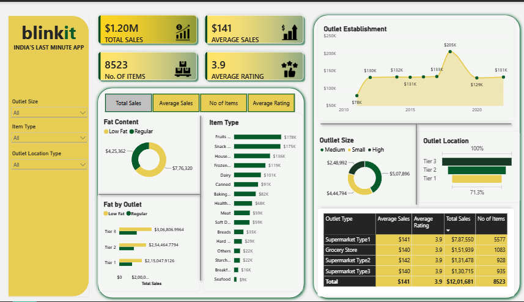

# BlinkIT Grocery Sales Dashboard (Power BI)

An interactive Power BI dashboard that analyzes sales, customer ratings and outlet performance for BlinkIT grocery data, built to answer: **which products, outlet types and locations drive the most sales?**

## Business Requirement
Conduct a comprehensive analysis of Blinkit's sales performance, customer satisfaction and inventory distribution to find key insights and optimization opportunities, using KPIs and visualizations in Power BI.

**KPIs required:** Total Sales, Average Sales, Number of Items, Average Rating

**Analysis requirements (all covered in the dashboard):**
1. Total sales by **fat content**, with average sales, item count and rating
2. Total sales by **item type**
3. **Fat content by outlet** for total sales
4. Total sales by **outlet establishment** year
5. Percentage of sales by **outlet size**
6. Sales by **outlet location**
7. All metrics by **outlet type**

## Dataset
- **Source:** BlinkIT grocery sales data (`BlinkIT_Grocery_Data.xlsx`)
- **Size:** 8,523 records, 12 columns
- **Columns:** Item Fat Content, Item Identifier, Item Type, Outlet Establishment Year, Outlet Identifier, Outlet Location Type, Outlet Size, Outlet Type, Item Visibility, Item Weight, Sales, Rating

## Data Cleaning (Power Query)
- Standardized inconsistent **Item Fat Content** labels: `LF` and `low fat` became **Low Fat**, and `reg` became **Regular** (5 labels reduced to 2).
- Checked data types and column quality before modeling.
- Noted that **Item Weight** has about 1,460 missing values; it is not used in the main KPIs.

## KPIs (DAX measures)
| KPI | Value |
|---|---|
| Total Sales | ~$1.20M |
| Average Sales per item | ~$141 |
| Number of Items | 8,523 |
| Average Rating | 3.9 |

## Dashboard Visuals
- Total sales by **item type** (bar chart)
- Sales split by **fat content** (donut chart)
- Sales by **outlet size** (donut chart)
- Sales by **outlet location tier** (funnel chart)
- Sales trend by **outlet establishment year** (line chart)
- Fat content vs location tier (clustered bar chart)
- **Outlet type** performance with total sales, average sales, items and rating (matrix)
- Interactive slicers: item type, outlet size, location tier and metric selector

## Key Insights
- **Fruits and Vegetables** (14.8%) and **Snack Foods** (14.6%) are the top-selling categories, together making up about 29% of sales.
- **Low Fat** items generate about **65%** of sales, versus 35% for Regular.
- **Tier 3** locations contribute the most sales (39%), ahead of Tier 2 (33%) and Tier 1 (28%).
- **Medium-sized** outlets lead with 42% of sales; High-sized outlets contribute only about 21%.
- **Supermarket Type 1** accounts for about **65%** of total sales, far ahead of the other outlet types.
- Seafood and Breakfast items have the lowest sales, a possible area to review.

## Tools Used
Power BI Desktop, Power Query, DAX, Excel

## Repository Contents
| File | Description |
|---|---|
| `BlinkIT_Dashboard.pbix` | Power BI report (open in Power BI Desktop) |
| `BlinkIT_Grocery_Data.xlsx` | Source dataset |
| `dashboard_screenshot.png` | Preview of the dashboard |

## How to Use
1. Download `BlinkIT_Dashboard.pbix` and `BlinkIT_Grocery_Data.xlsx`.
2. Open the `.pbix` file in Power BI Desktop.
3. If prompted, update the data source path to point to the Excel file.
4. Use the slicers to explore sales by item type, outlet size and location tier.

## Author
**Vrshy**: aspiring Data Analyst / Data Scientist
[LinkedIn](https://www.linkedin.com/in/varshiganesan) | [GitHub](https://github.com/vrshy)
